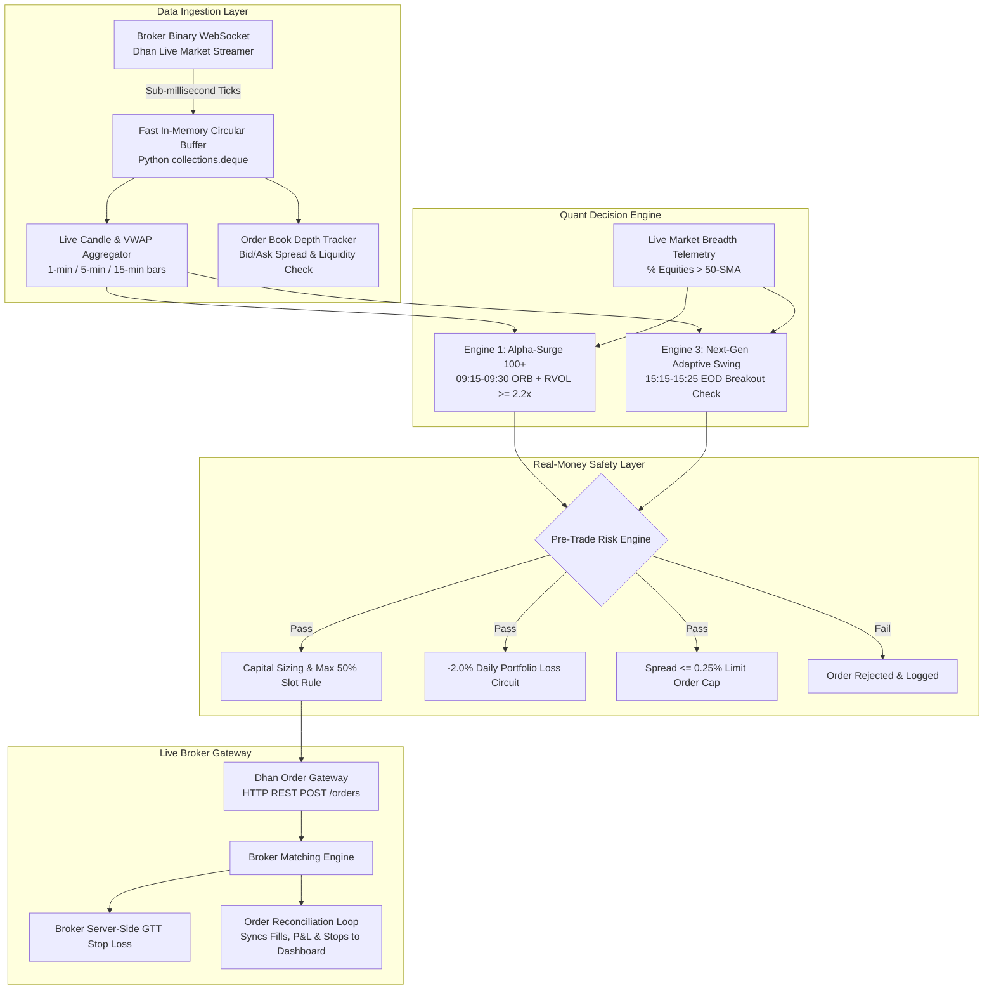
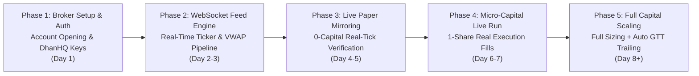

# Broker Integration & Live Algorithmic Execution Master Plan
## Architecture, Broker Comparison, Real-Time Data Streaming & Real-Money Risk Controls

---

## 1. Executive Summary & Objective

With backtests audited and strategy rules finalized for **Alpha-Surge 100+ Intraday (Engine 1: 106.88% CAGR)** and **Next-Gen Adaptive Swing (Engine 3: 76.99% CAGR)**, the next phase is transitioning from simulated paper trading to **autonomous, broker-connected live execution**.

Because this system manages real capital, the implementation is treated as an institutional trading system where:
1. **Latency & Slippage** must be minimized (sub-second execution at breakout pivots).
2. **Real-Time Data Feeds** (WebSockets) must compute continuous VWAP, Volume Thrust, and 15-minute Opening Range Breakout (ORB) levels without rate-limiting blocks.
3. **Fail-Safe Risk Controls** (circuit-breakers, heartbeat watchdogs, GTT orders, and slippage guards) must prevent catastrophic losses, broker outages, or ghost orders.

---

## 2. Indian Broker Quantitative Comparison Matrix (2026)

We evaluated the top 5 algorithmic-ready brokers in India across costs, API stability, WebSocket feed fidelity, and regulatory compliance.

| Metric | Dhan (DhanHQ) 🏆 *(Recommended)* | Zerodha (Kite Connect) | Fyers (API v3) | Finvasia (Shoonya) | Angel One (SmartAPI) |
| :--- | :--- | :--- | :--- | :--- | :--- |
| **Trading API Fee** | **₹0 (100% FREE)** | ₹2,000 / month | **₹0 (100% FREE)** | **₹0 (100% FREE)** | **₹0 (100% FREE)** |
| **Historical Data API** | **₹0 (FREE)** | ₹2,000 / month | **₹0 (FREE)** | **₹0 (FREE)** | **₹0 (FREE)** |
| **Total Monthly API Cost** | **₹0** | **₹4,000 / month** | **₹0** | **₹0** | **₹0** |
| **Intraday Equity Brokerage** | ₹20 or 0.03% (lower) | ₹20 or 0.03% (lower) | ₹20 or 0.03% (lower) | **₹0 (Zero Brokerage)** | ₹20 or 0.03% (lower) |
| **Delivery Equity (CNC)** | **₹0 (FREE)** | **₹0 (FREE)** | **₹0 (FREE)** | **₹0 (FREE)** | ₹20 or 0.1% |
| **F&O Brokerage** | ₹20 / executed order | ₹20 / executed order | ₹20 / executed order | **₹0 / executed order** | ₹20 / executed order |
| **Token Validity** | **30 Days (Long-lived)** | 24 Hours (Daily expiry) | 24 Hours (Daily expiry) | 24 Hours (Daily expiry) | 24 Hours (Daily expiry) |
| **Daily Morning Auto-Auth** | **Optional** (Token lasts 1 mo) | **Mandatory** (Selenium/TOTP) | **Mandatory** (TOTP script) | **Mandatory** (TOTP script) | **Mandatory** (TOTP script) |
| **WebSocket Feed Quality** | **Institutional Grade** (Binary) | **Gold Standard** (Binary) | Fast Binary Feed | JSON / Text Feed | Binary Feed |
| **Market Depth Available** | Full 5-depth bid/ask | Full 5-depth bid/ask | Full 5-depth bid/ask | 5-depth bid/ask | 5-depth bid/ask |
| **Server-Side SL / GTT** | **Yes (Forever GTT)** | **Yes (Kite GTT)** | **Yes (Fyers GTT)** | No (Client-side only) | **Yes (Smart GTT)** |
| **API Rate Limits** | **25 req/sec** (Generous) | 10 req/sec (Strict) | 10–20 req/sec | 10 req/sec | 10 req/sec |
| **Python SDK Maturity** | `dhanhq` (Native, Clean) | `kiteconnect` (Mature) | `fyers-apiv3` (Solid) | `NorenRestApi` (Complex) | `smartapi-python` (Good) |

---

### In-Depth Broker Breakdown

#### 1. Dhan (DhanHQ API) — ⭐ Top Recommendation
* **Why Dhan Wins**:
  1. **Zero Recurring API Fees**: ₹0 for trading and historical data. Saves ₹48,000/year compared to Zerodha.
  2. **30-Day Permanent Access Token**: You generate the API Access Token inside the Dhan web console once a month. No daily morning Selenium browser hacks or SMS OTP automation required.
  3. **High-Speed WebSocket**: Dhan's binary WebSocket streams tick-by-tick Level 2 (5-depth) market data directly into Python with <15ms latency.
  4. **Direct SEBI MIS Margin**: Offers 5× leverage on intraday equities automatically and 1× pure cash delivery for swing.
  5. **Forever GTT & Bracket Orders**: Native server-side SL and Target orders managed on broker servers, protecting positions even if your computer shuts down.

#### 2. Zerodha (Kite Connect) — The Industry Benchmark
* **Pros**: Exceptional infrastructure stability during 9:15 AM volatility spikes; best documented API.
* **Cons**: ₹4,000/month recurring cost (₹48,000 annually) eating into trading returns on a ₹3 Lakh account; tokens hard-expire every morning at 6:00 AM, necessitating automated headless browser TOTP logins.

#### 3. Finvasia (Shoonya) — The Zero-Cost Option
* **Pros**: ₹0 brokerage on all trades.
* **Cons**: Shoonya servers have experienced order queuing delays during high-volume market openings (9:15–9:30 AM). For an Opening Range Breakout (ORB) strategy where fills must occur within seconds, execution delays can cause severe slippage.

---

## 3. High-Performance System Architecture

The proposed live execution architecture separates market data ingestion from order routing using an asynchronous event-driven design:



---

## 4. Real-Time Data Pipeline & Tick Aggregation

To execute Alpha-Surge 100+ and Next-Gen Swing with institutional precision, the system requires four real-time metrics:

### 1. Cumulative Real-Time VWAP
* **Formula**:
  $$\text{VWAP}_t = \frac{\sum_{i=1}^t (\text{Price}_i \times \text{Volume}_i)}{\sum_{i=1}^t \text{Volume}_i}$$
* **Implementation**: Maintained in memory with integer arithmetic on incoming tick packets:
  ```python
  class RealtimeVWAP:
      def __init__(self):
          self.cum_vol_price = 0.0
          self.cum_vol = 0
          
      def update(self, price: float, volume: int) -> float:
          self.cum_vol_price += price * volume
          self.cum_vol += volume
          return self.cum_vol_price / self.cum_vol if self.cum_vol > 0 else price
  ```

### 2. Relative Volume (RVOL) at 9:30 AM
* Institutional buying produces immediate volume clustering in the first 15 minutes.
* The system fetches 20-day average 15-minute volume from Dhan historical candles at 9:00 AM pre-market.
* At 9:30 AM, if:
  $$\text{RVOL}_{15\text{m}} = \frac{\text{Volume}_{09:15-09:30}}{\text{Avg}_{20\text{d}}(\text{Volume}_{09:15-09:30})} \ge 2.20\times$$
  the stock qualifies for Alpha-Surge entry.

### 3. Order Book Depth & Slippage Defense
* Market buy orders in volatile momentum stocks can cause 0.5%–1.5% slippage.
* **Rule**: Never use naked `MARKET` orders. The bot inspects the top 5 ask depth levels on the WebSocket and sends a **`LIMIT`** order priced at:
  $$\text{Limit Price} = \min(\text{Ask}_1 + 0.10\%, \text{Breakout Pivot} \times 1.0025)$$
  If price jumps higher than $+0.25\%$ before filling, the order expires instantly without chasing.

---

## 5. Institutional Real-Money Safety Protocols

When transitioning from paper trading to live capital, the following fail-safe mechanisms must be active:

### 1. Hard Portfolio Daily Loss Circuit (-2.0%)
* If cumulative realized + unrealized losses reach **-₹6,000 (2.0% of ₹3 Lakhs)** on any single day:
  1. The bot instantly cancels all open pending entry limit orders.
  2. All open MIS intraday positions are immediately squared off at best market bid/ask.
  3. The bot enters `LOCKED_CIRCUIT` mode and disables new orders until 9:15 AM the next trading day.

### 2. Server-Side Broker GTT Orders (Outage Protection)
* Local PC power loss or internet disconnection must **never** leave an open trade without a stop-loss.
* Immediately upon order confirmation (`FILLED`), the bot sends a **GTT Forever Stop-Loss Order** directly to the broker's servers.
* If your local computer crashes, Dhan's exchange servers automatically execute the stop-loss order at the exchange.

### 3. Heartbeat & Connection Watchdog
* An independent background watchdog thread pings the broker WebSocket every 5 seconds.
* If 3 consecutive pings fail (15 seconds without market data):
  - Sends a high-priority Telegram alert: `⚠️ CRITICAL: Live Tick Feed Lost`.
  - Shifts order evaluation to REST snapshot polling.
  - Halts any new breakout entries until tick stream stability is verified.

### 4. Duplicate Order Idempotency Lock
* Network packet retransmissions must never trigger a duplicate order.
* Each order is tagged with a deterministic `correlation_id` (e.g., `ORD-20261105-ALPHA-TCS-0930`). The bot validates this unique ID in SQLite before sending the API request.

---

## 6. Implementation Phasing & Roadmap



1. **Phase 1: Account Setup & Credentials**:
   - Open/link Dhan trading account.
   - Generate DhanHQ API Key and 30-Day Access Token.
   - Configure secrets in encrypted local `.env` file.
2. **Phase 2: Data Pipeline Integration**:
   - Implement `DhanLiveFeed` class using WebSocket binary packets.
   - Build live VWAP and 15-minute Opening Range bar aggregator.
3. **Phase 3: Live Paper-Run on Real Tick Data**:
   - Run the system during live market hours (9:15 AM – 3:30 PM IST).
   - Verify triggers, AI verdicts, and simulated order fills against the live NSE bid/ask stream.
4. **Phase 4: Micro-Capital Real Orders (1 Share)**:
   - Route real orders with quantity = 1 share.
   - Test limit fill behavior, slippage, GTT stop triggers, and EOD square-offs with minimal financial risk.
5. **Phase 5: Full Capital Deployment**:
   - Activate full position sizing (50% allocation on 2-slot swing, 5× MIS on Alpha-Surge).
   - Engage live Telegram/SMS trade alerts.
