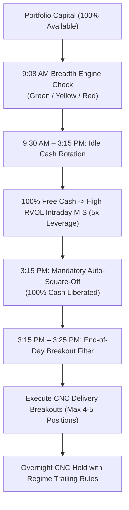
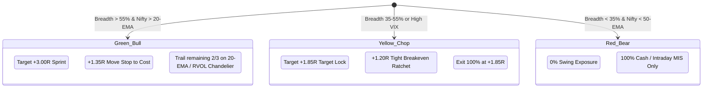

# Next-Gen Adaptive Hybrid 2.0 — Master Strategy Specification

This master specification codifies the operational rules, timing triggers, capital allocation model, and risk management parameters for **Next-Gen Adaptive Hybrid 2.0 (Upgraded)**, finalized through the strategy architecture review on 2026-11-03.

---

## 1. Strategy Hierarchy & Capital Orchestration

* **Dominant Master Engine:** `Next-Gen Adaptive Hybrid 2.0` operates as the sole dominant strategy controlling **100% of portfolio capital** (e.g. ₹3,00,000 base).
* **Dual-Horizon Execution:**
  * **Intraday Horizon (9:30 AM – 3:15 PM):** Deploys up to **100% of unallocated free cash** into high-momentum Nifty MIS trades with 5× SEBI margin.
  * **Swing Horizon (3:15 PM – 3:25 PM):** Automatically frees 100% cash via mandatory 3:15 PM MIS square-off and deploys CNC cash into confirmed Stage-2 VCP/Base breakouts.

---

## 2. Intraday Idle Cash Rotation Mechanics

| Parameter | Rule / Threshold |
| :--- | :--- |
| **Active Hours** | 09:30:00 IST to 15:15:00 IST |
| **Capital Allocation** | Up to **100% of available unallocated cash** |
| **Leverage** | 5× Intraday MIS (SEBI standard) |
| **Max Concurrent Trades** | 2 to 3 highest RS/RVOL stocks |
| **Trade Type** | Supercharged Momentum Intraday (Long & Short) |
| **Mandatory Exit** | **Strictly 15:15:00 IST** (Auto-squared off by worker) |
| **Cash Post-15:15** | 100% cash becomes liquid and available for CNC delivery swing orders |

---

## 3. Screener Discipline & Borderline Candidate Filtering

To eliminate bull traps and preserve risk asymmetry:

* **Maximum Permissible Stop Risk:** **Strict $\le 5.00\%$**.
  * Any candidate where $\frac{\text{Price} - \text{Stop}}{\text{Price}} > 5.00\%$ is immediately flagged **`NO ENTRY` / `AVOID`** (as seen in the HAL setup at 5.20% risk).
* **Minimum Volume Confirmation:** **Strict $\ge 1.30\times$ 20-Day Average Volume**.
  * Breakouts with volume $<1.30\times$ (such as HAL at 0.86x) are rejected without exception.
* **Relative Strength Threshold:** RS $\ge 70$ (Universe 80th percentile for aggressive tranches).

---

## 4. Swing Position Sizing & Concentration (High-CAGR 81.6% Architecture)

* **Target Position Count:** **2 concentrated high-conviction holdings** (`max_open_positions = 2`).
* **Capital per Stock:** **50% of total equity** (enabling maximum compounding velocity on +3.0R and RVOL Chandelier runners).
* **Portfolio Risk Ceiling:** With a strict 5.0% stop per trade, single-position loss impact is capped at **2.50% of portfolio equity**.
* **Idle Cash Rotation:** When holding 0 or 1 swing position (e.g., during chop, bear phases, or before setups trigger), the free unallocated 50% to 100% cash automatically generates intraday returns via morning MIS momentum.

---

## 5. 3-State Dynamic Trailing & Exit Rules

1. **Bull Regime (Green):**
   * Target: **+3.00R** sprint expansion.
   * Ratchet: At **+1.35R**, shift stop-loss to Breakeven (+0.1% buffer).
   * Trailing: Harvest 1/3 at +3.0R; trail remaining 2/3 using 20-EMA / 3× ATR RVOL Chandelier for monster compounding.
2. **Chop Regime (Yellow):**
   * Target: **+1.85R** quick target lock.
   * Ratchet: At **+1.20R**, immediately snap stop to Breakeven.
   * Exit: Book 100% at +1.85R to avoid round-trips during mean-reversion.
3. **Bear Regime (Red):**
   * **0% Swing Allocation.** No overnight delivery exposure.
   * Capital remains 100% in cash or short/long intraday MIS.

---

## 6. Regime Engine & UI Governance

* **Autonomous Calculation:** Daily at **09:08:00 IST**, AlphaFlow samples Nifty 50, Nifty 500, % stocks above 50-DMA, 20-EMA slope, and India VIX to determine the baseline traffic light state.
* **Manual Override:** The dashboard switchboard retains an override toggle enabling discretionary regime pinning (Bull / Chop / Bear) whenever unexpected geopolitical or macro events unfold.
