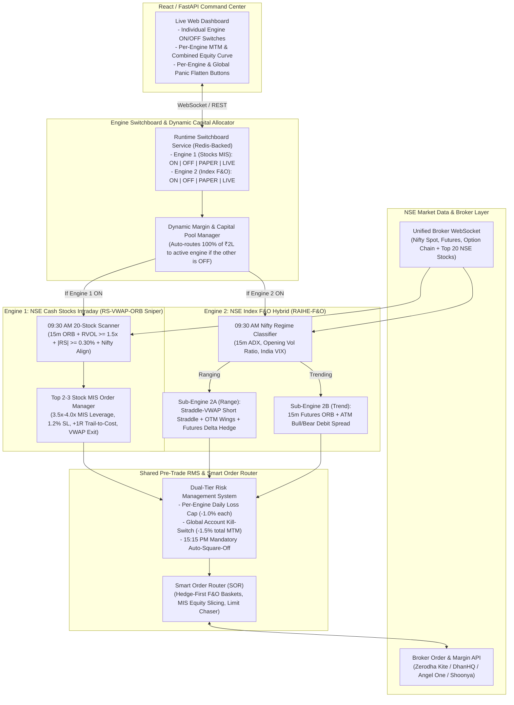

# Detailed Technical Implementation Plan: Dual-Engine Intraday Trading Platform (NSE Stocks MIS + Index F&O Hybrid)

> [!IMPORTANT]
> **Dual-Engine Architecture with Independent Runtime Controls**:
> This plan implements **both** backtest-proven engines inside a single unified application:
> 1. **Engine 1 (`STOCK_SNIPER_MIS`)**: The **RS-VWAP-ORB Sniper** scanning the Top 20 NSE Nifty 50 Cash Stocks (`RVOL >= 1.5x`, `|RS| >= 0.30%`, `NiftyAlign`, `1.2% SL`, `+1R Trail-to-Cost`, `VWAP Exit`, `3.0R Target`).
> 2. **Engine 2 (`FO_HYBRID_RAIHE`)**: The **Regime-Adaptive Index F&O Engine** trading Nifty 50 / BankNifty Options & Futures (09:30 AM Regime Classification → Straddle-VWAP Theta Harvester on Range days or ORB + Debit Spread on Trend days).
>
> **Independent Switching & Capital Reallocation**: Each engine has its own independent **Master ON/OFF Toggle**, **Execution Mode Selector (`OFF` | `PAPER_SIM` | `LIVE_BROKER`)**, **Capital Allocation Slider**, and **Emergency Flatten Button** on the Command Center UI and REST API—allowing you to switch either engine off before or during market hours without interrupting the other.

---

## 1. Dual-Engine System Architecture & Runtime Toggle Flow



---

## 2. How the Individual Engine ON/OFF Switch & Capital Routing Work

### 2.1 Three-State Toggle per Engine (`OFF` | `PAPER_SIM` | `LIVE_BROKER`)
Each engine (`engine_stocks_mis` and `engine_fo_hybrid`) maintains an independent state in the `EngineSwitchboard` (persisted in Redis + SQLite/PostgreSQL):

| Engine 1 (Stocks MIS) State | Engine 2 (F&O Hybrid) State | How Capital (₹2,00,000) & Margin Are Routed Automatically |
| :---: | :---: | :--- |
| **`ON (LIVE)`** | **`OFF`** | **100% of Capital (`₹2,00,000`)** is assigned to **Engine 1 (NSE Stocks MIS)**. Trades Top 2–3 qualifying stocks with up to `3.5x–4.0x` MIS leverage. Engine 2 is completely dormant (`0` CPU/order activity). |
| **`OFF`** | **`ON (LIVE)`** | **100% of Capital (`₹2,00,000`)** is assigned to **Engine 2 (Index F&O Hybrid)**. Trades 2 Lots of Hedged Nifty Straddles or 1 Lot Futures + Spreads. Engine 1 is completely dormant. |
| **`ON (LIVE)`** | **`ON (LIVE)`** | **Split or Overflow Routing (Configurable)**:<br/>- **Default Split Mode**: `65%` (`₹1,30,000` = 2 Hedged Nifty F&O Lots) to **Engine 2** + `35%` (`₹70,000` × 4x MIS = `₹2,80,000` stock buying power) to **Engine 1**.<br/>- **Smart Fallback Mode**: If Engine 1 finds `0` stocks passing `RVOL >= 1.5x` at `09:30 AM`, its unused `₹70,000` capital automatically rolls over to Engine 2 for that day! |
| **`ON (LIVE)`** | **`PAPER_SIM`** | **Engine 1** places real broker orders with `100%` of live capital, while **Engine 2** runs in shadow paper-trading mode on live ticks so you can compare its simulated PnL side-by-side on the dashboard without risking capital. |

### 2.2 Behavior When You Switch an Engine `OFF` Mid-Day (During Market Hours)
When you toggle an engine from `ON` to `OFF` on the dashboard during market hours (`09:15 AM – 15:15 PM`), the UI prompts you with two safe modes:
1. **`Graceful Pause (Block New Entries)`**: Immediately stops the engine from taking any new trades or re-entries today, while continuing to manage Stop-Loss, Trail-to-Cost, and 15:15 PM square-off for any already-open positions of that engine.
2. **`Immediate Flatten & Disable`**: Immediately cancels all pending SL/limit orders belonging *only* to that engine, squares off all open positions of that engine at market/limit-protect within `< 1 second`, and locks that engine to `OFF`—while leaving the other engine completely untouched.

---

## 3. Project Directory Structure

We will scaffold the project at `./alphaflow-intraday`:

```text
alphaflow-intraday/
├── pyproject.toml                       # Python 3.12 dependencies
├── config/
│   ├── settings.yaml                    # Capital (₹2,00,000), Engine ON/OFF defaults, Split ratios, RMS limits
│   ├── universe_nse_stocks.yaml         # Top 20 liquid NSE Nifty 50 tickers + MIS leverage multipliers
│   └── brokers.yaml                     # Zerodha Kite / DhanHQ / Angel One / Shoonya credentials & endpoints
├── src/
│   ├── core/
│   │   ├── events.py                    # TickEvent, BarEvent, SignalEvent, OrderBasketIntent, EngineStateEvent
│   │   ├── switchboard.py               # Runtime ON/OFF/PAPER/LIVE Toggle & Dynamic Capital Allocator
│   │   └── database.py                  # SQLite / PostgreSQL ledger for per-engine orders, PnL, and state
│   ├── data/
│   │   ├── feed_manager.py              # Unified WebSocket stream (20 NSE Stocks + Nifty Spot/Fut/Options)
│   │   ├── bar_builder.py               # Real-time 1m / 5m / 15m OHLCV + Intraday VWAP + RVOL calculator
│   │   ├── option_chain.py              # ATM Strike resolver + Combined Premium Straddle-VWAP tracker
│   │   └── greeks_bsm.py                # Fast Black-Scholes IV, Delta, Gamma, Theta calculator
│   ├── engines/
│   │   ├── base_engine.py               # Abstract Engine interface with enable()/disable()/flatten() hooks
│   │   ├── stock_sniper_mis.py          # ENGINE 1: RS-VWAP-ORB Sniper (NSE Cash Equity MIS)
│   │   └── fo_hybrid_raihe.py           # ENGINE 2: RAIHE-F&O Regime-Adaptive Index Options & Futures
│   ├── risk/
│   │   ├── rms_governor.py              # Per-engine SL (-1.0%) + Global MTM Kill-Switch (-1.5%) + 15:15 EOD
│   │   └── cost_calculator.py           # Exact Indian MIS Equity & F&O STT, NSE Turnover, GST & Brokerage
│   ├── execution/
│   │   ├── smart_order_router.py        # Tags every order with `engine_id`; handles F&O wings-first & MIS orders
│   │   └── adapters/
│   │       ├── paper_simulator.py       # Live-tick shadow simulator with realistic Indian tax/slippage deduction
│   │       └── indian_brokers.py        # Adapter for DhanHQ / Zerodha Kite / Angel One SmartAPI
│   ├── backtest/
│   │   └── dual_backtester.py           # Runs Engine 1 Alone, Engine 2 Alone, or Combined Dual-Engine on real NSE data
│   └── api/
│       └── main.py                      # FastAPI server + WebSocket live streamer + Toggle REST API
└── dashboard/
    └── index.html                       # Interactive Command Center UI (Engine switches, MTM charts, Trade Blotter)
```

---

## 4. API & Database Specification for Independent Engine Control

### 4.1 Engine Switchboard Configuration Schema (`config/settings.yaml`)
```yaml
account:
  initial_capital_inr: 200000.0
  global_max_daily_loss_pct: 1.5       # Hard flatten all engines if combined MTM hits -₹3,000 (-1.5%)
  global_trailing_profit_lock_pct: 2.0 # Lock profit once combined MTM crosses +₹4,000 (+2.0%)
  mandatory_square_off_time: "15:15:00"

allocation_mode: "SMART_OVERFLOW"      # "SPLIT_FIXED" | "SMART_OVERFLOW"

engines:
  engine_stocks_mis:
    name: "NSE Cash Stock Sniper (RS-VWAP-ORB)"
    enabled: true
    mode: "PAPER_SIM"                  # "OFF" | "PAPER_SIM" | "LIVE_BROKER"
    capital_share_pct: 40.0            # Auto-scales to 100% if engine_fo_hybrid.enabled == false
    max_engine_daily_loss_pct: 1.0
    params:
      orb_minutes: 15
      rvol_min: 1.5
      relative_strength_min_pct: 0.30
      nifty_alignment_required: true
      top_k_stocks: 3
      mis_leverage: 3.5
      stop_loss_pct: 1.2
      target_rr: 3.0
      trail_to_cost_at_1r: true
      vwap_cross_exit_after_1r: true

  engine_fo_hybrid:
    name: "Nifty 50 F&O Hybrid (RAIHE-F&O)"
    enabled: true
    mode: "PAPER_SIM"                  # "OFF" | "PAPER_SIM" | "LIVE_BROKER"
    capital_share_pct: 60.0            # Auto-scales to 100% if engine_stocks_mis.enabled == false
    max_engine_daily_loss_pct: 1.0
    params:
      underlying: "NIFTY"
      lot_size: 65
      orb_minutes: 15
      adx_trend_cutoff: 25.0
      vol_ratio_cutoff: 1.2
      straddle_leg_sl_pct: 20.0
      trail_surviving_leg_to_cost: true
      dynamic_futures_delta_hedge: true
      trend_target_rr: 2.5
```

### 4.2 REST API Endpoints for Live Switching (`src/api/main.py`)
- `GET /api/v1/engines/status`: Returns live status (`OFF` | `PAPER_SIM` | `LIVE_BROKER`), allocated capital, active positions, and intraday MTM PnL (Gross & Net of STT/Brokerage) for **Engine 1**, **Engine 2**, and **Combined Portfolio**.
- `POST /api/v1/engines/{engine_id}/toggle`:
  - Payload: `{"mode": "OFF" | "PAPER_SIM" | "LIVE_BROKER", "mid_day_action": "GRACEFUL_PAUSE" | "IMMEDIATE_FLATTEN"}`
  - Atomically updates the engine state, recalculates capital allocation between the engines, and (if `IMMEDIATE_FLATTEN` is selected) squares off only that engine's open positions.
- `POST /api/v1/engines/{engine_id}/flatten`: Emergency 1-click flatten for a single engine without affecting the other engine.
- `POST /api/v1/portfolio/panic-flatten-all`: Master kill-switch that flattens both engines simultaneously and locks the system for the day.
- `POST /api/v1/backtest/run`: Runs the historical backtest on our cached real NSE dataset with custom toggles (`Engine 1 Only`, `Engine 2 Only`, or `Both Enabled`) and returns the equity curve and tearsheet to the UI.

---

## 5. Minimalist Financial Terminal UI Specification (Inspired by Zerodha Kite, Console & DhanHQ)

> [!IMPORTANT]
> **Anti-"AI Slop" Design Language**:
> The UI will strictly avoid generic AI dashboard tropes (no neon purple/cyan gradients, no glowing glassmorphism cards, no oversized emojis, no rounded pill buttons). Instead, it follows the **Zerodha Kite + Zerodha Console + Linear** institutional design system:
> - **Typography**: Clean geometric sans (`Inter` / `-apple-system`) for labels and **strictly tabular monospace (`JetBrains Mono` with `font-variant-numeric: tabular-nums`)** for every price, PnL, strike, percentage, timestamp, and order ID so columns align to the decimal point.
> - **Color Palette**: High-contrast, low-fatigue slate-zinc dark/light surface (`#0f1115` base canvas, `#161920` elevated table surface, `1px solid #232730` hairline borders, muted `#8b949e` secondary labels, crisp `#10b981` institutional emerald for profits/fills, `#ef4444` crimson for losses/rejections, and `#f59e0b` amber for pending/upcoming triggers).
> - **Information Density**: Compact `36px` row heights, keyboard shortcuts (`Esc` to close modals, `F` to flatten, `1–4` to switch views), and instant client-side filtering without page reloads.

### 5.1 Five Core Views in the Minimalist Navigation Bar

#### View 1: **Dashboard (Live Command Center)**
- **Top Account Telemetry Strip**:
  - `Opening Balance (₹2,00,000)` | `Margin Used / Available` | `Live Intraday MTM` | `Est. Taxes & STT Today` | `Net Realized + Unrealized PnL` | `Global Daily Stop (-1.5% / -₹3,000)` | `[ Flatten All ]` button.
- **Engine Control Header (Two Clean Horizontal Modules)**:
  - **Module 1: `NSE Equity MIS — RS-VWAP-ORB Sniper`**:
    - Segmented Switch: `OFF` | `PAPER` | `LIVE`
    - Status metrics: `Allocated: ₹80,000 (or ₹2,00,000 if F&O OFF)` • `Leverage: 3.5x` • `Active Positions: 2/3` • `Today Net: +₹2,410` • `[ Square Off Stocks ]`
  - **Module 2: `NSE Index F&O — RAIHE Hybrid (Nifty 50)`**:
    - Segmented Switch: `OFF` | `PAPER` | `LIVE`
    - Status metrics: `Allocated: ₹1,20,000 (2 Lots)` • `09:30 Regime: RANGING (ADX 19.4)` • `Net Delta: -0.04` • `Today Net: +₹1,840` • `[ Square Off F&O ]`
- **Split Workspace**:
  - **Left (60%)**: Interactive Intraday MTM Equity Curve + Drawdown chart (`TradingView Lightweight Charts` style) with toggleable overlays for `Combined`, `Stocks MIS Only`, and `Index F&O Only`.
  - **Right (40%)**: **Upcoming Signals & Pre-Trigger Watchlist** (stocks and option strikes approaching their breakout or VWAP trigger right now).

#### View 2: **Signals & Order Book (Upcoming, Executed, Success & Failed/Rejected)**
- **Tab A — Upcoming Trades Queue (Live Scanner & Armed Triggers)**:
  - Displays stocks and F&O legs currently being stalked by the active engine(s), showing:
    - `Symbol` | `Engine` | `Setup Type (15m ORB / Straddle-VWAP)` | `Current LTP` | `Trigger Price` | `Distance to Trigger (%)` | `RVOL` | `RS vs Nifty` | `Status (ARMED / WAITING_0930 / FILTERED_OUT)` | `[ Skip Signal ]`
- **Tab B — Executed Trades & Order Lifecycle Blotter**:
  - Every order dispatched today or historically, filterable by status (`ALL` | `COMPLETE (Success)` | `SL_HIT` | `TARGET_HIT` | `TRAILED_COST` | `REJECTED / FAILED` | `CANCELLED`):
    - `Order ID` | `Time (IST)` | `Engine` | `Instrument (e.g. ADANIENT MIS / NIFTY 24500 CE)` | `Side (BUY/SELL)` | `Qty` | `Trigger/Entry` | `Exit/LTP` | `SL Price` | `Target` | `Gross PnL` | `STT+Charges` | `Net PnL` | `Execution Status Badge & Failure Reason (if rejected, e.g., "RMS Margin Gate" or "RVOL Below 1.5x")`

#### View 3: **Positions & Live Greeks**
- Clean tabular view of currently open intraday legs with real-time tick-by-tick MTM, individual leg Stop-Loss modification controls, `Trail-to-Cost` status indicator, and individual `[ Exit Leg ]` action buttons.

#### View 4: **Reports & Analytics (`Day` | `Week` | `Month` | `Year` Breakdown — Zerodha Console Style)**
- **Time-Horizon Selector**: Instant tabs for **`Daily Report`**, **`Weekly Summary`**, **`Monthly Breakdown`**, and **`Yearly Tearsheet (245 Real NSE Days)`** + Engine Filter (`Combined` | `Stocks MIS Only` | `Index F&O Only`).
- **GitHub / Zerodha Console Style Daily PnL Calendar Heatmap**:
  - Visual grid of all 12 months where each trading day square is shaded by net return (emerald for profit days, crimson for loss days, grey for no-trade days). Clicking any day opens that exact day's trade-by-trade execution log.
- **Period Aggregation Table (`Day / Week / Month / Year`)**:
  - Columns: `Period (e.g., Nov 2025, Week 44, or 2026-10-28)` | `Active Days` | `Total Trades` | `Won / Lost` | `Win Rate %` | `Gross PnL (₹)` | `Brokerage + STT + GST (₹)` | `Net Realized PnL (₹)` | `ROI % on ₹2L` | `Max Drawdown %` | `Profit Factor`.
- **Daily Returns Distribution & Tax Ledger**:
  - Itemized breakdown of statutory charges paid (`STT`, `NSE Exchange Turnover Tax`, `SEBI Turnover Fee`, `Stamp Duty`, `18% GST`, and `Brokerage`) + 1-click **`Export CSV / JSON Report`**.

#### View 5: **Strategy Lab & Real-NSE Backtest Explorer**
- Interactive parameter controls where you can toggle Engine 1 ON/OFF, Engine 2 ON/OFF, adjust `MIS Leverage (2x–5x)`, `SL %`, `RVOL Cutoff`, or `Compounding ON/OFF`, and re-run the backtest across the real NSE dataset in `< 1 second`.

---

## 6. Execution & Verification Steps

1. **Step 1 — Scaffold Full Dual-Engine Codebase**: Create `./alphaflow-intraday` with `EngineSwitchboard`, `StockSniperMISEngine`, `FOHybridRAIHEEngine`, `RMSGovernor`, `SmartOrderRouter`, and `IndianCostCalculator`.
2. **Step 2 — Integrate Real NSE Datasets & Multi-Horizon Report Generator**: Wire the cached real NSE 5-minute and 1-year datasets into `dual_backtester.py` and `report_engine.py` to generate exact **Day, Week, Month, and Year** tearsheets, calendar heatmaps, upcoming signal queues, and order success/failure logs.
3. **Step 3 — Build FastAPI Backend & Zerodha/Linear-Inspired Minimalist UI**: Build the FastAPI server and the ultra-clean, tabular-monospace financial terminal UI (`dashboard/index.html`) with all 5 views (`Dashboard`, `Upcoming & Executed Orders`, `Positions`, `Day/Week/Month/Year Reports`, and `Strategy Lab`).
4. **Step 4 — End-to-End Verification**: Launch the live server, verify all views, test switching Engine 1 and Engine 2 `ON`/`OFF` individually, verify the Day/Week/Month/Year reports, and confirm the UI renders with crisp institutional precision.
